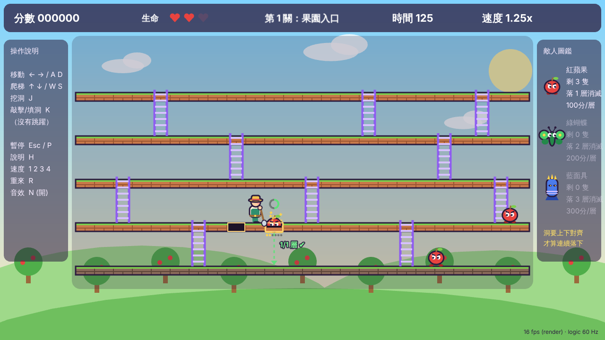

# 果園危機 Orchard Panic

An original HD 2D cartoon *spiritual remake* of the 1981 Apple Panic gameplay: walk, climb ladders, dig holes, trap enemies and knock them down through **consecutive aligned floors**. There is no jump. All art and sound are original and generated in code.



## Play
```bash
npm install
npm run dev
```
Open the URL Vite prints. **Enter** starts the game (**L** picks the start level, 1–10), **T** opens the mechanics test level, **H** shows help.

Campaign: levels 1–5 add one red apple each (1 → 5); from level 6 the total stays 5 and one apple becomes a green flytrap per level (level 10 = 5 flytraps). Levels are generated by `node tools/gen-levels.mjs`.

| Action | Modern keys | Classic keys |
|---|---|---|
| Move | ← → / A D | J K |
| Climb | ↑ ↓ / W S | I M |
| Act on the LEFT tile | J | A |
| Act on the RIGHT tile | K | S |

One key, three actions (6 pulses each): solid floor → **dig**, existing hole → **fill**, trapped enemy → **pound it down**. A held key pauses after each completed action; release and press again to continue.

Esc/P pause · 1–4 world speed (1.0/1.25/1.5/2.0x) · R restart · N mute all · B music on/off · C (menu) switch keymap.

Music: two original chiptune-style loops generated live with Web Audio (`src/game/music/score.ts`) — no audio files.

Walking onto an open hole drops **you** to the floor below too. Enemies are plants: red apple needs a 1-floor fall, green flytrap 2, blue cactus 3 — in one continuous fall through holes in the **same column**.

## Develop
```bash
npm run typecheck   # tsc strict
npm run test        # vitest: rules, fall chains, clock determinism
npm run build       # production bundle in dist/
```
- `src/core/` — deterministic 60 Hz simulation (no Phaser).
- `src/game/` — Phaser 4.2.1 scenes, input, HUD, sound.
- `src/levels/` — validated JSON levels.
- `tools/playtest/` — Playwright keyboard bots used for browser verification (`LEVEL=level06 node tools/playtest/play-level.cjs`).
- `tools/gen-levels.mjs` — deterministic generator for `src/levels/level01–10.json`.

Project rules: `CLAUDE.md` · Design: `docs/GDD.md` · Status: `docs/PROGRESS.md` · Decisions: `docs/DECISIONS.md`.
